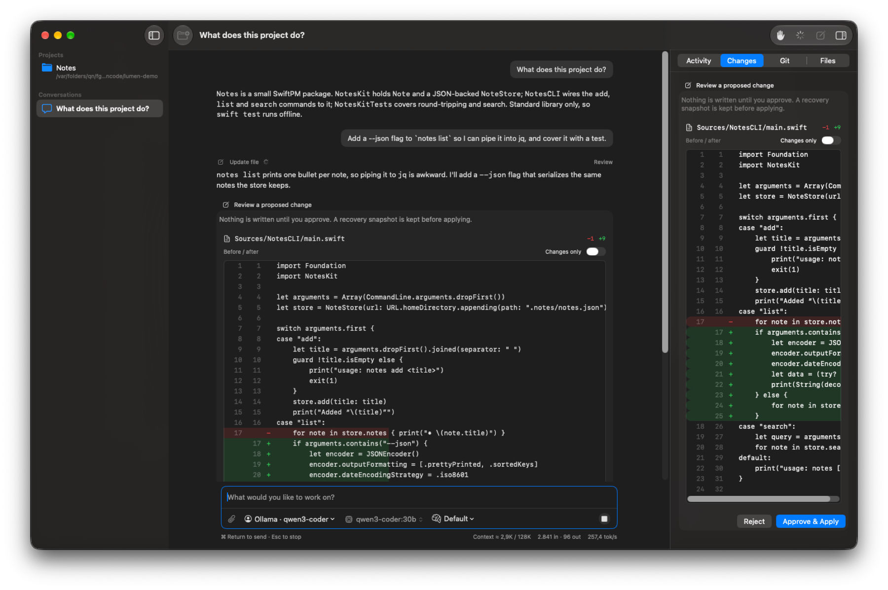
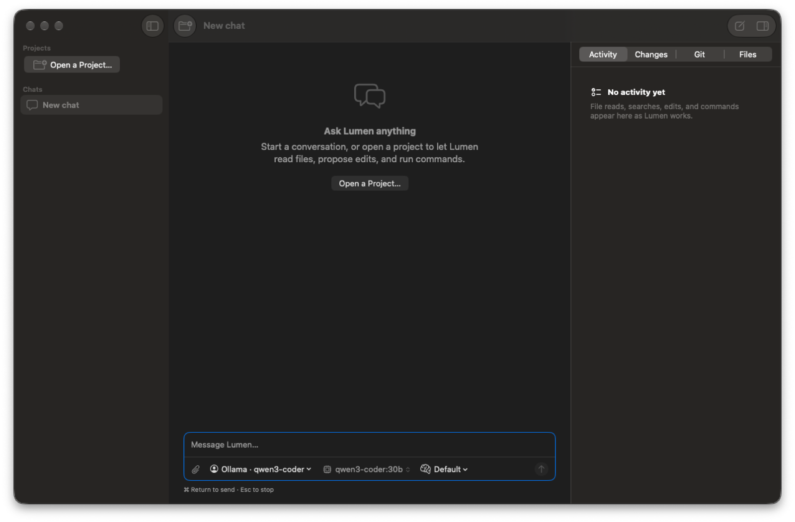
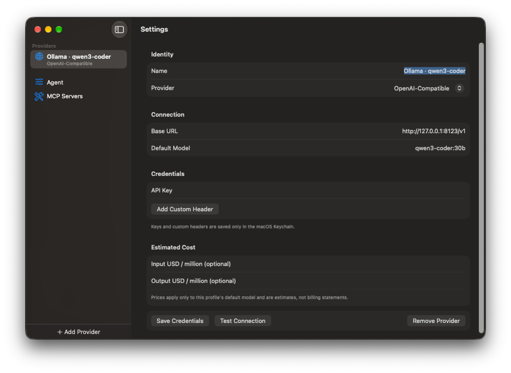

# 🚨 DISCLAIMER

> [!CAUTION]
> This is straight up ai slop made with deepseek v4.1 flash and gpt6 astra. Not a single line of code was checked by me or any human in this instance. Use at your own risk. 
> Only this disclaimer was added by me, everything else is done by an LLM.

<div align="center">

# Lumen

**A native macOS coding agent.** Chat with a model that can actually read, search and edit your project — with your approval, your API keys, and no Electron in sight.

  



</div>

---

## Why it's different

- 🪶 **Lightweight** — native SwiftUI, no web views, no runtime dependencies. ~150 MB idle, sub-second cold launch.
- 🔑 **Your keys, your Mac** — credentials live only in the macOS Keychain. Nothing else is stored anywhere sensitive.
- 👀 **Nothing changes without you** — every edit shows a red/green diff and every command asks first (until you say otherwise).
- 🧠 **Any provider** — OpenAI, Anthropic, OpenRouter, OpenCode, ChatGPT account sign-in, or a local Ollama-compatible server.
- 🗂 **Projects, not just chats** — the sidebar remembers your folders and keeps each project's conversations separate.

## Features

| | |
|---|---|
| **Agent tools** | list files, read numbered text, search literals, edit, patch many files, run shell commands |
| **Approvals** | Review everything · Auto-approve edits · Full Auto — plus a denylist that no mode can override |
| **Plan mode** | read-only exploration, a checklist kept in the Plan tab, and one-click Start Building |
| **Visual diffs** | numbered red/green review, per-file selection for multi-file patches, guarded Undo that survives restarts |
| **Workspace panel** | Activity, Changes, Files and Git tabs, one keystroke away (⌘⌥I); right-click a file to open it in your editor or reveal it in Finder |
| **Context care** | token gauge, auto-summarizing of old turns, streaming responses with a Stop that really stops |
| **Extras** | MCP servers, attachments, reasoning summaries, per-response cost estimates, chat search and rename |

## Screenshots

<div align="center">

**Open a folder and ask for a change** — the agent reads the code, proposes an edit, and waits for you.


**Or just start chatting** — no project required.



**Bring your own provider** — local endpoints included.



</div>

## Quick start

Needs full Xcode plus [XcodeGen](https://github.com/yonaskolb/XcodeGen):

```sh
brew install xcodegen
swift test            # offline, deterministic
./scripts/build.sh    # generates the project and builds the app
open build/Build/Products/Debug/Lumen.app
```

Then add a provider in **Lumen → Settings → Providers**, pick a model in the composer, and hit **⌘O** to open a project.

`project.yml` is the source of truth; the generated `.xcodeproj` is ignored by Git. `LumenCore` holds all the testable logic, `LumenApp` is just the UI shell.

### Handy keys

| Key | Action |
|---|---|
| ⌘Return | Send |
| Esc | Stop |
| ⌘N | New conversation |
| ⌘O | Open project |
| ⌘⌥I | Toggle workspace panel |
| ⌘, | Settings |

## Providers

**Settings → Providers → Add Provider** ships presets for OpenAI, **Anthropic**, **OpenRouter**, **OpenCode Console**, the legacy **OpenCode Zen** gateway, and any local OpenAI-compatible server (normally a URL ending in `/v1`; an empty key is fine for local). Each routes through its own hand-written streaming client — no provider SDKs. Use **Test Connection** to fetch the model list, or **Enter model ID…** if the server doesn't support listing.

### ChatGPT account sign-in (no API key)

Choose **ChatGPT Account → Continue with ChatGPT** and approve in your browser. Lumen uses OpenAI's [open-source app OAuth flow](https://developers.openai.com/siwc/token-sharing-open-source/sign-in) — its own client ID, PKCE, and signed ID-token validation. No Codex client ID, no private endpoints, no external CLI. Tokens live in Keychain only, registrations survive restarts, and **Sign Out** revokes them.

> This flow is documented by OpenAI as a preview for open-source apps. Plan access and commercial distribution may need OpenAI's approval — verify before you release.

## How it works

**Approvals.** *Review everything* (default) asks before each edit and command, *Auto-approve edits* applies file changes immediately, and *Full Auto* also runs commands without prompting. The command denylist blocks dangerous programs and options in every mode, and approval can never override it.

**Plan mode.** Toggle *Plan* in the composer for a read-only first pass. Lumen can inspect the project and ask questions, but edits and commands are not advertised or accepted. It records the steps with `update_todos`; the Plan tab shows the checklist and a **Start Building** button that leaves plan mode and executes it. The checklist is saved with the chat and stays in later requests even after context compaction.

**Edits.** `edit_file` replaces one exact, unique text block; `apply_patch` takes a whole `*** Begin Patch` and shows a single review where you pick which files land. Files are checked and atomically swapped with permissions, ACLs and timestamps preserved, and each one is backed up to `.lumen/backups` before it changes — that's what Undo restores, even after a restart. Add `.lumen/` to your project's `.gitignore` if you don't want snapshots tracked. The agent cannot edit Git internals or `.lumen` itself.

**Safety.** Every path from the model is resolved (symlinks included) and must stay inside the project root, enforced with descriptor-based access. Reads cap at 1 MB; search stops after 32 MB or 100 matches. Commands run in their own process group with timeouts, truncated output, and a scrubbed environment — the agent never sees your API keys.

**Context.** The composer footer estimates the request against the model's context window. Past roughly three quarters, the same provider summarizes the older half and that summary is sent in place of those turns. Your transcript keeps everything; only the request is compacted.

**Storage.** Provider metadata, models, reasoning effort, system prompt and your projects live in `~/.lumen/config.json`. API keys, custom headers and OAuth tokens stay in Keychain. Conversations (messages and drafts) are saved as JSON and restored across launches.

**MCP.** Add [Model Context Protocol](https://modelcontextprotocol.io) servers over stdio — their tools appear as `mcp__<server>__<tool>` and run with the server's own permissions, so only add servers you trust.

## Releasing

```sh
./scripts/release.sh    # ad-hoc signed DMG
```

With a paid Apple Developer Program membership, add both variables and the same script signs with your Developer ID, notarizes, staples, and verifies the result:

```sh
NOTARY_PROFILE=lumen-notary DEVELOPER_ID_APPLICATION="Developer ID Application: Name (TEAMID)" ./scripts/release.sh
```

Either way it archives, signs under Hardened Runtime, and writes `dist/Lumen.dmg` holding the app next to an **Applications** shortcut, so installing is just a drag.

**First launch without a Developer ID.** Gatekeeper blocks an ad-hoc build until the recipient approves it once: right-click the app and choose **Open** on macOS 14, or use **System Settings → Privacy & Security → Open Anyway** on macOS 15 and later. The app is identical either way — notarization only removes that step.

## Contributing

Run `swift test` before opening a PR; CI runs the same tests plus a full app build. Keep `LumenCore` free of UI code, and keep every credential in Keychain.

## License

MIT — see [LICENSE](LICENSE). The system prompt and prompt-assembly text are adapted from OpenCode; see [THIRD_PARTY_NOTICES.md](THIRD_PARTY_NOTICES.md).
